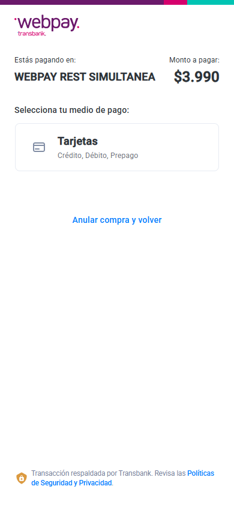
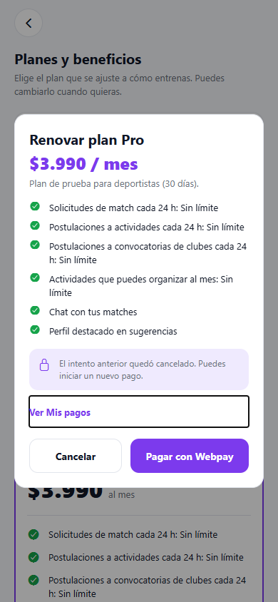

# Webpay: abandonar, volver y pagar otra vez

Corrección del 11 de noviembre de 2026.

## Problema encontrado

La app guardaba el enlace de un pago pendiente y permitía abrirlo nuevamente.
El formulario de Webpay puede rechazar esa reutilización. Consultar el resultado
con `commit` antes de completar el formulario también provocaba respuestas 422
de Transbank, convertidas en 502 por el backend.

El entorno local tenía además enlaces de apertura y retorno con una IP anterior
del equipo. Se corrigieron a la IP LAN actual. `iniciar-dev.ps1`, en la raíz del
workspace, ahora calcula esas dos direcciones al iniciar el entorno de Expo Go.

## Comportamiento corregido

- Al regresar del navegador o volver a abrir la contratación, se consulta el intento anterior.
- El nuevo endpoint autenticado `POST /api/v1/payments/webpay/cancel` consulta el estado en Transbank; no ejecuta un cobro ni un reembolso.
- Si el intento no se completó, se registra `CANCELLED`. El siguiente pago recibe una orden, un token y un enlace nuevos.
- Si Webpay ya lo autorizó, se recupera como `APPROVED`, se conserva la suscripción y no se inicia otro pago automáticamente.
- Si el proveedor no responde o no tiene un estado definitivo, se conserva el intento para revisarlo; no se inventa una cancelación ni un pago aprobado.
- Los enlaces firmados de intentos finalizados devuelven 409, evitando que la app los vuelva a abrir como formularios activos.
- Una confirmación tardía no elimina el intento nuevo del almacenamiento del dispositivo.
- Se cubrió la carrera entre una cancelación y una autorización: una autorización verificada puede recuperar un intento cancelado; la suscripción se extiende una sola vez, también bajo concurrencia en PostgreSQL.
- La app recupera el estado al volver a primer plano. La web también lo hace al regresar con Atrás, incluyendo páginas restauradas desde la caché del navegador.
- El resultado y el modal permiten abrir **Mis pagos**. La web actualiza el historial después de cerrar el intento.

La separación entre consultar un pago abandonado y confirmar un pago completado
sigue el [flujo documentado por Transbank](https://transbankdevelopers.com/documentacion/webpay-plus).

## Verificación

- App: **170 pruebas aprobadas**, TypeScript y lint aprobados.
- Web: **71 pruebas aprobadas**, compilación de producción aprobada. Permanece un aviso previo de lint por `clubId` sin uso en el simulador de gateway.
- ms-pago: **419 pruebas aprobadas con PostgreSQL**, incluida recuperación concurrente de una autorización tardía.
- Gateway: **106 pruebas aprobadas** en las suites de proxy y pagos ejecutadas.
- Compilación Android servida correctamente por Expo Go.
- Navegador con vista móvil: formulario de **Transbank INTEGRATION** abierto dos veces, abandono entre intentos, tokens y órdenes diferentes, cancelaciones persistidas, enlaces antiguos rechazados e historial visible; sin errores JavaScript.
- Navegador web: regreso con **Atrás**, cancelación del intento anterior y apertura de un nuevo formulario; sin errores JavaScript.
- No se introdujeron tarjetas ni se realizaron cobros. Los intentos de QA utilizados para la verificación quedaron cancelados.

Los logs y resultados están en `artifacts/webpay-recuperacion-*`,
`artifacts/verificacion-webpay-recuperacion.json` y
`artifacts/verificacion-webpay-web-recuperacion.json` del workspace.
Las pruebas SQL usan una base separada de las bases de la aplicación.

## Revisar desde el celular

Recargar el proyecto en Expo Go y usar el mismo Wi-Fi del equipo. Iniciar un pago,
cerrar el navegador sin completarlo, volver a la app y abrir nuevamente el pago.
El intento anterior debe cerrarse y el formulario nuevo debe cargar normalmente.
Los intentos anulados se pueden consultar desde **Mis pagos**. La comprobación
automática cubrió el navegador y la compilación Android; falta confirmar el gesto
de cierre del navegador en el teléfono específico del equipo.

## Capturas de integración

