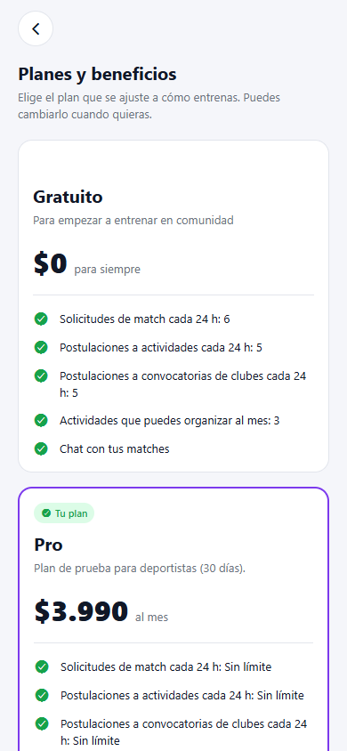
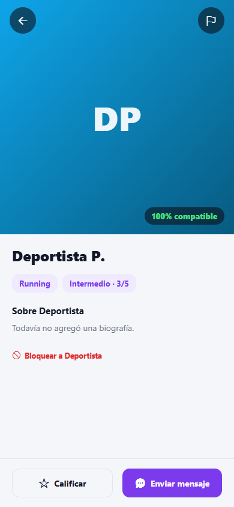
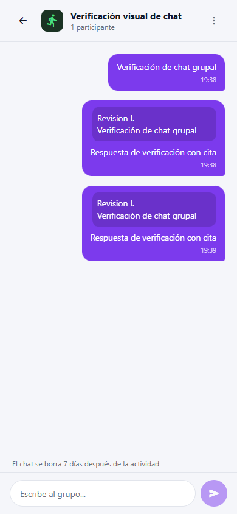

# App móvil: visual de sprint 2 con backend

Revisión del 11 de noviembre de 2026 sobre `main`, usando como referencia visual
`origin/respaldo-sprint2` (`e21cb1b`). La rama del compañero
`origin/feat/chat-respuestas-perfil` (`3f94dc0`) ya está integrada: sus contratos
de respuestas, bloqueos y preselección se conservaron.

El merge anterior mantenía las API reales, pero había diferencias de presentación
con sprint 2. Se corrigieron en el código de las pantallas; no se reemplazaron
los servicios conectados por los servicios simulados de aquella rama.

## Cambios

| Pantalla o flujo | Resultado |
| --- | --- |
| Inicio del club, listas de chats y matches | Espaciados y controles de sprint 2; siguen usando datos y permisos del servidor. |
| Chat individual | Burbujas, citas, pie de respuesta, fotos con proporción y mapas de sprint 2. Responder envía `replyTo`; tocar una cita recupera el original desde Matching. |
| Chat grupal | Responder, visualizar citas, recuperar el original y abrir el perfil del autor usan la capa de datos real de Activities. Se evita duplicar envíos mientras la solicitud está en curso. |
| Entrada directa al chat grupal | Carga la ficha de la actividad y la lista de chats, de modo que el título y el deporte no dependan de haber visitado otra pantalla. Se respeta el modo de lectura de actividades finalizadas. |
| Teclado en los tres chats | Se recuperó el ajuste del margen inferior de sprint 2 al abrir el teclado. |
| Perfil público | Foto con proporción, controles sobre la imagen, distancia y botones de sprint 2. Perfil, match, calificación y bloqueos permanecen conectados. |
| Perfil del club | Se recuperaron las tarjetas de ubicación y contactos desde la API y los colores de cada estado de postulación. No se inventan datos de contacto cuando no existen. |
| Planes del deportista | Tarjetas de sprint 2 con beneficios y precios de ms-pago. Se mantienen uso del plan, renovación y restricciones por tipo de cuenta. La compra no activa planes localmente. |
| Contratación | Se recuperaron los componentes y medidas del modal de sprint 2, manteniendo confirmación, pago pendiente y reintentos del servidor. |
| Disponibilidad | El editor de días y horas ya guarda las franjas en las preferencias de Users y las recupera al recargar o iniciar sesión. Antes solo se guardaban en el teléfono. |
| Actividades | Se retiró código de demostración sin uso que podía modificar horarios o cancelaciones solo en memoria. Las notificaciones siguen viniendo del gateway. |

La disponibilidad conserva el formato visual `Lun 07:00, 18:00 · Sáb 10:00`.
Cada hora nueva crea una franja de hasta 60 minutos; las franjas existentes
conservan su hora de término. El límite de Users es 21 franjas por semana.
El editor explica estas reglas. Un error al guardar no se presenta como un éxito local.
No se migran automáticamente los textos libres de versiones antiguas de la demo.

## Variables de entorno y trabajo del equipo

`main` usa siempre el gateway. No requiere `EXPO_PUBLIC_PAGOS_REALES` ni un
selector de datos simulados. Para trabajar en otro equipo basta con configurar
un gateway al que ese equipo o teléfono pueda acceder:

```dotenv
# .env.local de la app, excluido de Git
EXPO_PUBLIC_API_URL=http://IP-DEL-PC:8000/api/v1
```

Con Expo Go, si la variable no está definida o está vacía, se usa el equipo del
QR de Expo y el puerto 8000. Para un APK hay que definir explícitamente una URL
alcanzable desde el teléfono. Se normalizan espacios y barras finales de la URL.

Las variables del frontend solo configuran la conexión y la compilación;
no sustituyen el backend. Para desarrollar sin instalarlo, la compañera puede
apuntar al mismo entorno de desarrollo compartido que el resto del equipo.
Los cambios visuales pueden hacerse desde una rama creada con `main` actualizado.

En esta revisión se reconstruyeron los servicios locales, se preservó el volumen
existente y se guardó previamente un respaldo PostgreSQL en
`Ms_gateway/backups/antes-ajuste-visual-20261111.sql` (excluido de Git).
El gateway respondió con HTTP 200 tanto en localhost como en la IP LAN del equipo.

## Validación

- App: **166 pruebas aprobadas**, TypeScript y lint sin errores ni advertencias, y exportación web de Expo aprobada.
- Matching: **203 pruebas aprobadas con PostgreSQL**.
- Activities: **138 pruebas aprobadas con PostgreSQL**.
- Clubes: **6 pruebas de migraciones y preselección aprobadas con PostgreSQL**.
- Estas pruebas usaron `sportmatch_visual_tests_20261111`, separada de las bases de la aplicación.
- Navegador Edge con vista móvil de 390 × 844: inicio, perfil propio, guardado y recarga de horarios, planes, matches, perfil público, chat individual, respuesta individual, chat grupal, respuesta grupal, perfil de club y panel del club; **sin errores JavaScript**.
- Se enviaron respuestas con citas desde ambas pantallas reales y se comprobó su persistencia en la API.
- Los horarios de la cuenta de revisión se restauraron después de comprobar el guardado. Los mensajes de verificación se dejaron en las conversaciones de QA.
- Los 404 de una postulación inexistente y el 403 al consultar un club sin permisos se gestionaron con los estados previstos de la interfaz.
- No se ejecutaron cobros ni se generó un APK. Falta revisar teclado, permisos y gestos en un teléfono físico.

Evidencia completa y logs locales en `artifacts/ajuste-visual-20261111-*` y
`artifacts/verificacion-visual-backend-20261111.json` del workspace.

## Pendientes concretos del backend

| Capacidad | Estado actual de la app |
| --- | --- |
| Subida de adjuntos del chat | Muestra y amplía fotos recibidas, pero no simula el envío de archivos locales. Falta un servicio de subida con URL accesible para la otra persona. |
| Varias fotos por deportista | Users guarda una foto por perfil. El editor respeta ese límite; no presenta cinco fotos locales como sincronizadas. |
| Foto del club | Falta un endpoint para subirla y persistirla; no se simula el cambio en el teléfono. |
| Contraseña actual → contraseña nueva | Falta ese endpoint de Users. La recuperación por correo sí está conectada. |
| Retirar postulación a una convocatoria de club | Falta el endpoint; la app no borra la postulación solo en memoria. Retirarse de una actividad sí tiene API propia. |
| Filtrar búsqueda por horario de otra persona | Suggestions no entrega la disponibilidad pública. Guardar la disponibilidad propia ya funciona; ese filtro sigue pendiente. |
| Push en un APK | Requiere proyecto EAS y credenciales de plataforma configuradas. Las notificaciones dentro de la app siguen conectadas al backend. |

Estos pendientes no son conflictos Git. También sigue pendiente que los dueños
de Ms-club y sportmatch-web cambien la rama predeterminada de GitHub a `main`;
el código integrado ya está publicado allí.

## Capturas






